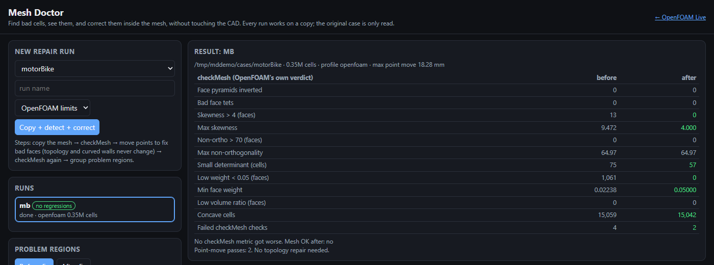
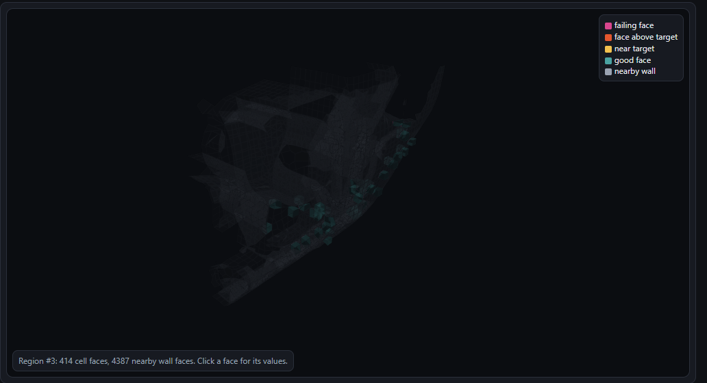
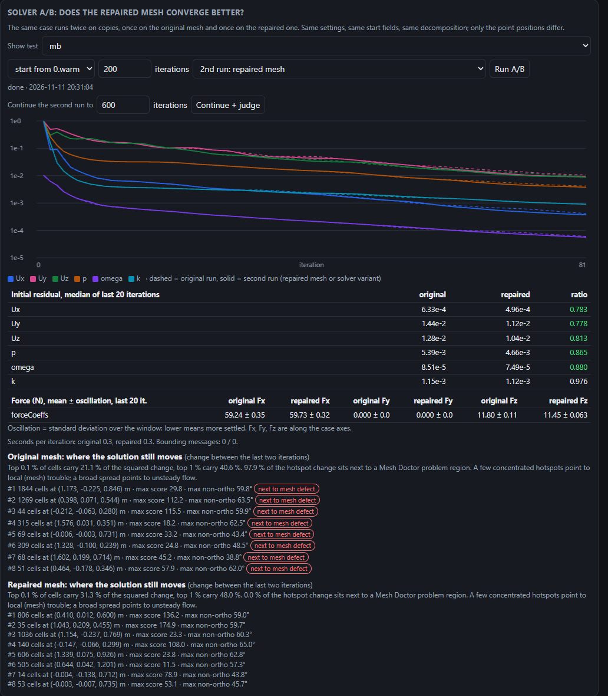
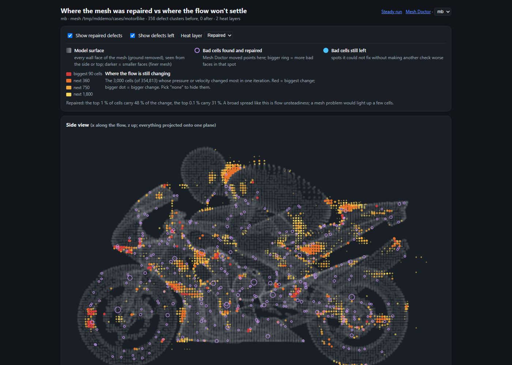
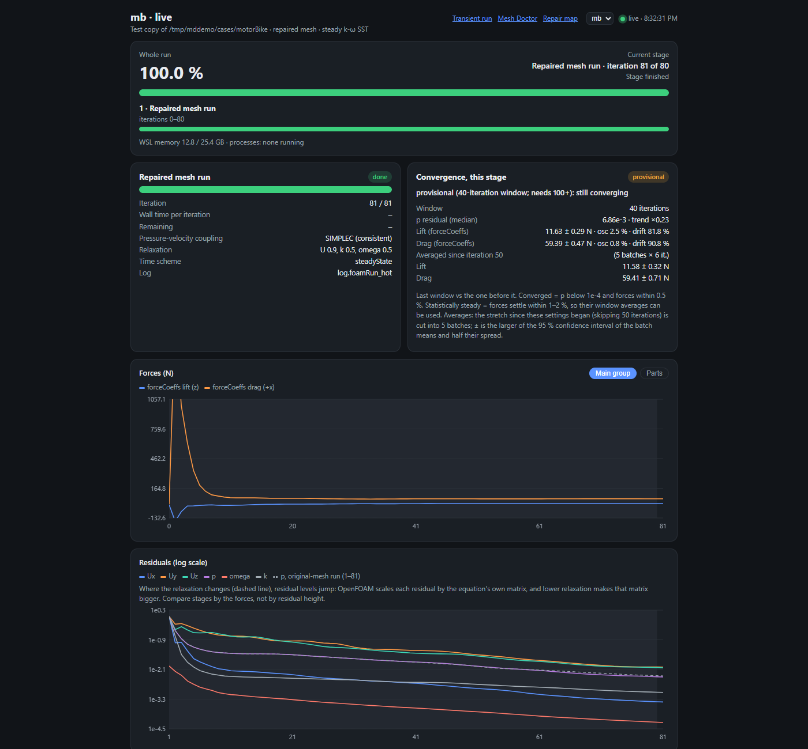

# Dashboard tour

Start it with `meshdoctor serve` (inside WSL on Windows), then open `http://localhost:8765`. The screenshots below come from OpenFOAM's motorBike tutorial, the same run as in the README's first-run section.

## Mesh Doctor: `/meshdoctor`

- **Start a repair:** pick a source case (from the `cases` folder), give the run a name, pick the limits (OpenFOAM's or strict), and press **Copy + detect + correct**. The copy, checks and repair run in the background; the current step shows in the run list.
- **Runs** lists every repair in the workspace, marked "no regressions" or with the number of checks that got worse.
- **Result** shows `checkMesh` before and after, side by side: green means better, red means worse. Below it are the number of passes, any collapsed faces, and the largest point move.
- **Problem regions** lists the defect clusters, largest first. Switch between *before* and *after* to see what the repair left.
- **3D view:** click a cluster to see its faces and cells, coloured by badness, with the nearby wall. Drag to rotate, scroll to zoom.
- **Link to a run:** `/meshdoctor?run=<name>` opens a run directly, and `&cluster=<n>` opens its n-th cluster as listed.

### Solver A/B test (same page, below the result)

- Start an A/B test for the selected run: start fields, iterations, and what the second run changes (the repaired mesh, or a solver-setting variant), then **Run A/B**.
- The chart shows the residuals of both runs as they solve: dashed lines are the original mesh, solid lines the second run.
- When it finishes, the tables compare:
  - the residual level of each field, with the ratio second / original (green when it went down);
  - force means ± oscillation;
  - seconds per iteration.
- Below them, for each run, are the places where the solution still moves most, each marked when it sits next to a Mesh Doctor problem region. In the motorBike example, 98 % of the original mesh's hotspot change sits next to defects, and none of the repaired mesh's does.
- **Continue + judge** carries the second run on to more iterations and gives the convergence verdict on the `/run` page.

## Repairs vs hotspots: `/meshmap`

Side and top views of the model, everything projected onto one plane:
- grey: the model's walls (ground removed); darker means smaller faces;
- purple rings: bad cells found and repaired, bigger ring = more bad faces there;
- blue dots: bad cells the repair could not fix without making another check worse;
- red to yellow dots: the cells where the flow still changes most, for the heat layer picked at the top (red = biggest change).

The note under the legend says whether the change is concentrated in a few cells (pointing to mesh trouble) or spread widely (pointing to unsteady flow).

Make the map with `meshdoctor map <name> --hot "Label=<case>"`. `/meshmap?name=<name>` opens a given map.

## Steady run live: `/run`

For a run as it solves, or after: the second run of an A/B test (pick it at the top, or open `/run?label=<name>`):
- progress, time per iteration and the solver settings in use;
- drag and the vertical force of each force group (downforce or lift, named from the case);
- residuals, with the original-mesh run dashed for comparison;
- the live convergence judge on the latest window, with averages and their uncertainty;
- memory in use and the solver processes running on the machine.

## Transient run live: `/`

For the transient case given with `serve --case <case>` (or the `live_case` setting): forces against time, the averaging window (`fieldAverage` start), the time step, and the end time from `system/controlDict`.

## Something looks wrong?

- **A page is empty:** check that the case or workspace holds what that page reads (`meshdoctor config` shows the folders in use).
- **Start is refused:** another solver or mesher is running ("one big job at a time"), or the job would not fit in free memory. The message says which.
- **The browser says it cannot connect:** the server listens on 127.0.0.1 only. From another machine, use the SSH tunnel in the README.
