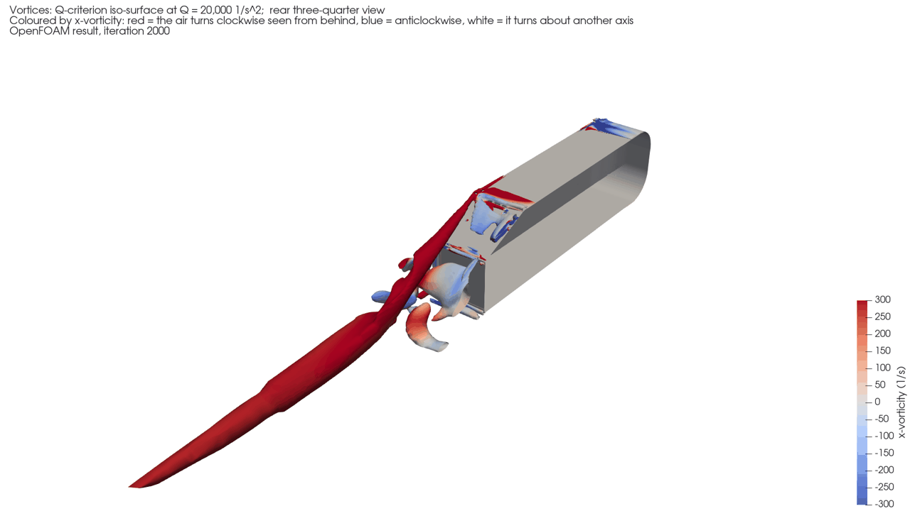
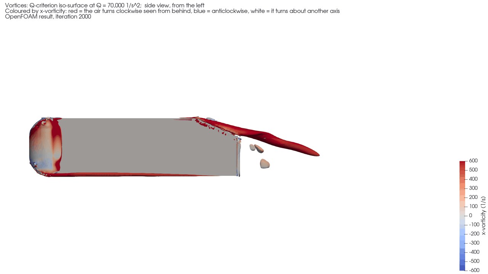
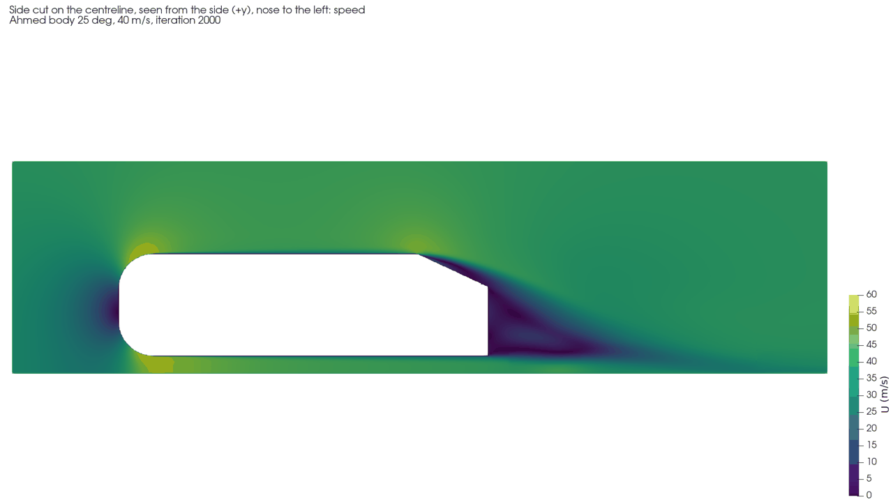
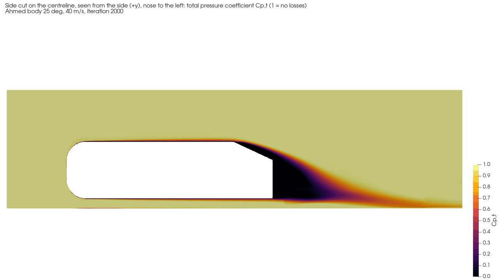
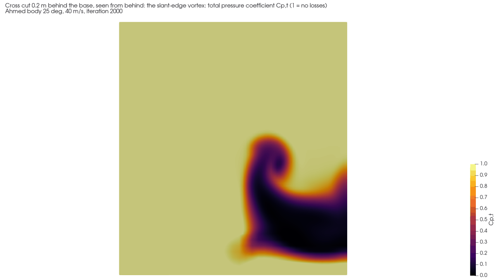
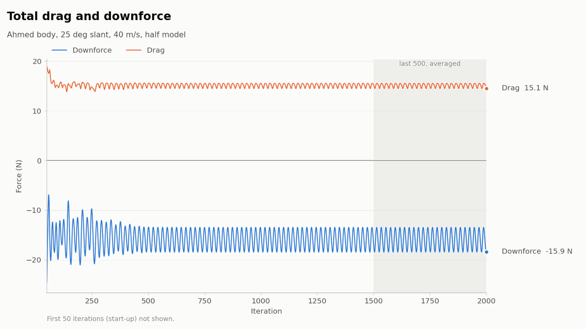
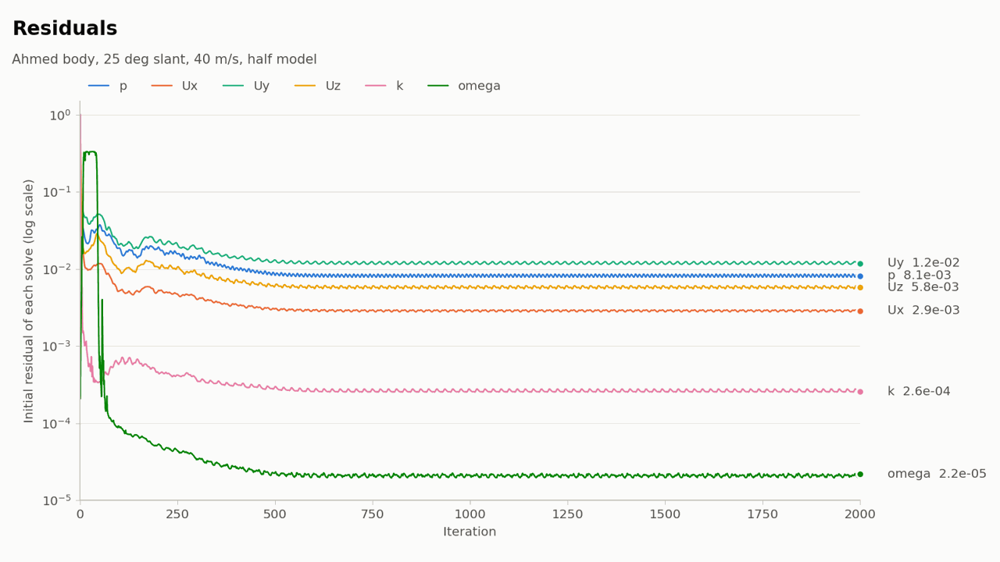
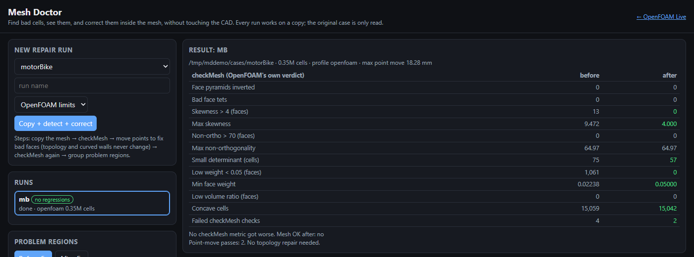

# Gallery

What the toolkit's scripts make, all from the worked example (`examples/ahmed-body`: Ahmed body, 25 degree slant,
40 m/s, 836 k cells, steady k-omega SST). Each picture names the script and command that made it, so you can make
the same set for your own case (`/cfd-toolkit:pictures <case>` in Claude Code does all of it).

## Vortices: `vortex_views.py`

Q-criterion iso-surfaces coloured by the streamwise vorticity (red clockwise seen from behind, blue anticlockwise).

## Cut planes: `cut_views.py`

Planes from a JSON list (`examples/ahmed-body/cuts.json`), coloured by speed, Cp or total-pressure coefficient Cp,t
(1 = no losses, so dark areas are wakes and vortex cores).

## Convergence charts: `plot_convergence.py`

Forces with the averaging window shaded, residuals on a log scale, and a summary table with the window means and the
drift between windows.

## Dashboard: `meshdoctor serve`

Live progress of a running case, Mesh Doctor repairs and the repair map: see [dashboard.md](dashboard.md).

## How accurate are these?

The same case on three meshes and at a second slant angle, against the wind tunnel: [validation.md](validation.md).
