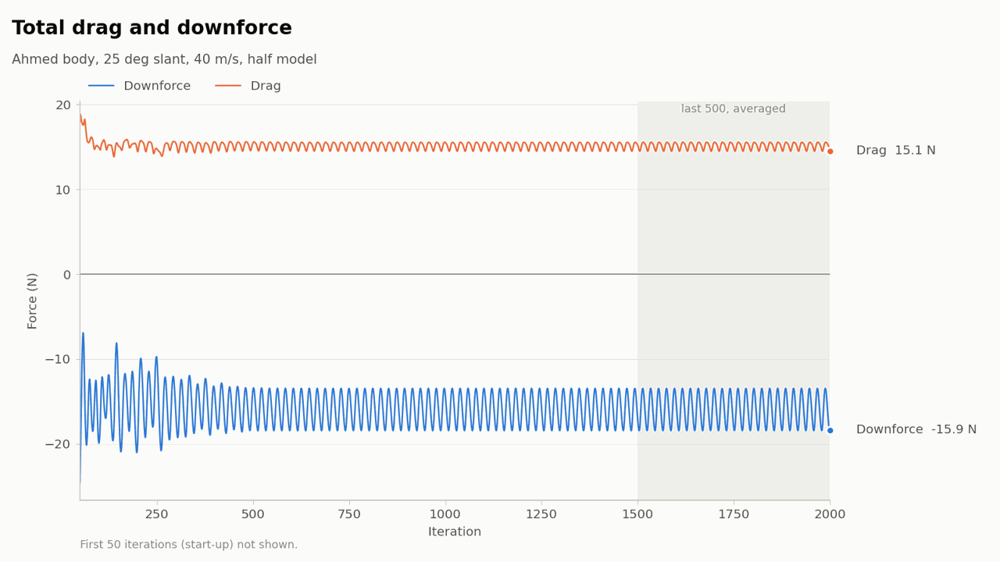
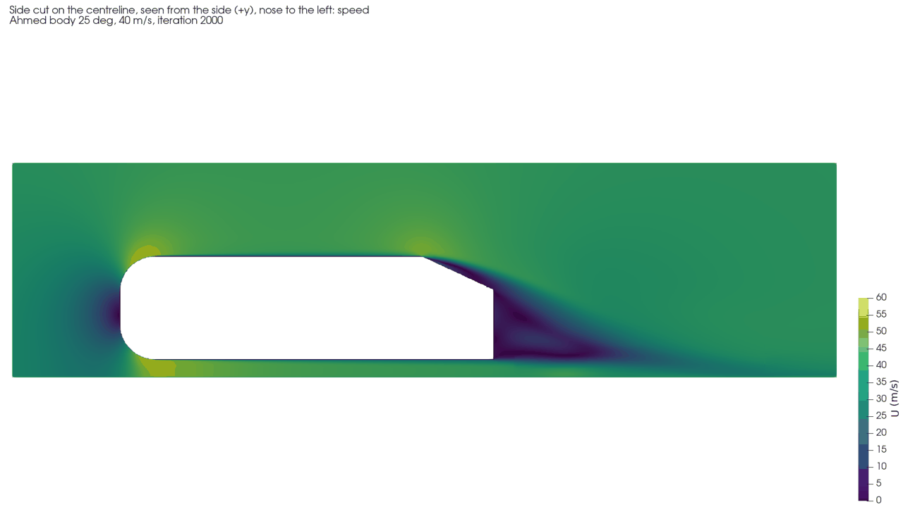
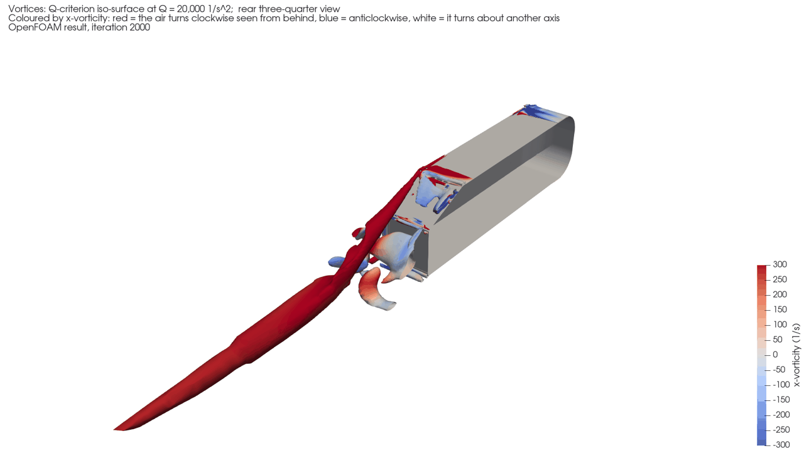
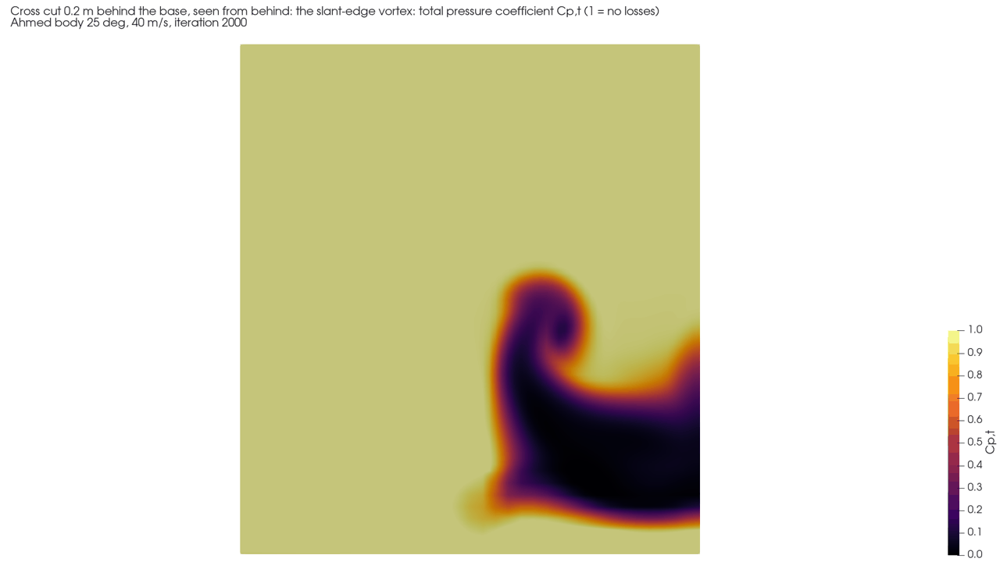

# Worked example: the Ahmed body, start to finish

The Ahmed body is the standard test shape for car aerodynamics: a box with a rounded nose and a slanted rear, measured
in wind tunnels many times. This example takes it through the whole toolkit, so you can see every step work, and
compare the answer with the measurements, before you trust it with your own car.

Everything here is generated from published dimensions: no CAD file, no team data.

| Step | Command | Time measured (laptop, 6 solver cores) |
|---|---|---|
| 1. Geometry + mesh | `./Allmesh` | ~3 min (snappyHexMesh 172 s), 1.5 GB |
| 2. Check / repair the mesh | `meshdoctor full <case> ahmed_fix` | ~30 s |
| 3. Solve | `./Allrun 6 2000` | 33 min (1.0 s per iteration) |
| 4. Charts and numbers | `plot_convergence.py` | seconds |
| 5. Pictures | `cut_views.py`, `vortex_views.py` | ~1 min |
| 6. Compare with the wind tunnel | this page | |

## The case

- **Shape:** length 1044 mm, width 389, height 288, front edges rounded R100, 50 mm above the ground, 25 degree slant
  (222 mm long). `make_ahmed.py` writes it as an STL (`--slant 35` for the other classic angle, `--stilts` for the
  four supports the wind-tunnel model stands on).
- **Axes:** the toolkit's convention: x forward (the nose faces +x, the air flows toward -x), z up, ground at z = 0.
- **Half model:** y >= 0 with a symmetry plane, so it costs half the cells. The force coefficients use half the
  frontal area (0.056 m2), so they equal the full body's.
- **Flow:** 40 m/s (Re = 2.8 million on the length, like the Lienhart & Becker measurements), moving ground, steady
  k-omega SST with wall functions, potentialFoam start.
- **Mesh:** 0.1 m background cells, refinement boxes for the wake, the slant and the gap under the body, 3.1-6.3 mm
  on the body, 5 boundary layers. Result: **836 k cells**, max non-orthogonality 61.5 deg, max skewness 2.9,
  y+ 4-271 on the body (average 45, right for wall functions).

## 1. Geometry and mesh

```bash
. /opt/openfoam14/etc/bashrc
cp -r examples/ahmed-body $FOAM_RUN/ahmed && cd $FOAM_RUN/ahmed
./Allmesh
```

`Allmesh` writes the STL, extracts the sharp edges, runs blockMesh and snappyHexMesh (serial), copies `initial/` to
`0/`, and prints the checkMesh summary. Expect one failed check, "concave cells": snappyHexMesh meshes always have
some, and they are harmless at this level.

## 2. Check and repair the mesh

```bash
meshdoctor full $FOAM_RUN/ahmed ahmed_fix
```

Result on this mesh: every check already inside Mesh Doctor's targets (max non-orthogonality 61.5 below 65, skewness
2.9 below 4, no bad tets, no small determinants), so it repaired nothing and regressed nothing. The 19,507 concave
cells (2.3 %) are snappyHexMesh's normal refinement-level steps. That is the result you want to see on a clean mesh;
your own meshes are where it earns its keep.

## 3. Solve

```bash
./Allrun 6 2000        # 6 cores, 2000 iterations; run again with a bigger number to continue
```

`Allrun` decomposes, starts from potentialFoam and runs `foamRun` in parallel, then reconstructs the last time. On
6 cores it took 1,992 s for 2,000 iterations. Watch it live with `meshdoctor serve --case $FOAM_RUN/ahmed`
(or `/cfd-toolkit:dashboard` in Claude Code): iteration, time left, forces and residuals.

## 4. Charts and numbers

```bash
python3 skills/paraview-post/scripts/plot_convergence.py $FOAM_RUN/ahmed charts ahmed "Ahmed body 25 deg, 40 m/s" \
    --uinf 40 --rho 1.205 --window 500
```

Add `--total forcesTotal` for the force chart. Last 500 iterations (half model, 40 m/s):

| | Value | How settled |
|---|---|---|
| Cd | **0.280** | -0.02 % between the two halves of the window |
| Cl | 0.295 (lift, upward) | |
| Drag | 15.1 N (half body) | -0.03 % last 500 against the 500 before |
| Residuals | p 8e-3, U 3e-3 to 1e-2, k 3e-4 | 1.3-3.6 orders down |

The forces keep a small regular wiggle (drag ±0.5 N, a period of about 25 iterations): the steady solver can't fully
settle the unsteady wake behind the base. That is normal for bluff bodies, and why you average a window rather than
read the last value (the last single value is Cd 0.269).



## 5. Pictures

```bash
S=skills/paraview-post/scripts; export PYTHONPATH=/usr/lib/python3/dist-packages; touch $FOAM_RUN/ahmed/case.foam
pvbatch --force-offscreen-rendering $S/cut_views.py $FOAM_RUN/ahmed/case.foam reconstructed pictures     examples/ahmed-body/cuts.json "Ahmed body 25 deg, 40 m/s, iteration {it}" --walls ahmed --uinf 40
pvbatch --force-offscreen-rendering $S/vortex_views.py $FOAM_RUN/ahmed/case.foam pictures "20000,70000,200000"     --walls ahmed --views rear34,top,side
```

Q levels are the usual 3,000 / 10,000 / 30,000 scaled by (40/15)^2 for the higher speed. About 15 s each on this mesh.





The red tube is the slant-edge vortex that rolls up along the side edge of the slant: the Ahmed body's signature at
25 degrees. The cross cut 0.2 m behind the base shows it as the round loss core above the base wake.
`pressure_spots.py` finds nothing unphysical: the lowest Cp, -2.7, is on the edge where the roof meets the slant,
where the air turns fastest.

## 6. Compare with the wind tunnel

| | Cd | Source |
|---|---|---|
| This example (k-omega SST, 836 k cells, half model) | **0.280** | last 500 of 2,000 iterations |
| Wind tunnel, 25 deg slant | 0.285 | Ahmed, Ramm & Faltin 1984 (SAE 840300), 60 m/s |
| Difference | **-1.7 %** | |

Read it honestly:

- The drag agrees within 2 %, which is better than steady RANS usually does here. At 25 degrees the real flow
  separates at the top of the slant and reattaches before the base, and two-equation RANS models are known to get
  that wrong (often fully separated or fully attached), so part of the agreement can be luck. The side cut shows a
  slow layer lying along the slant rather than a clean bubble and reattachment.
- The model has no stilts (the wind-tunnel model stands on four; `--stilts` adds approximate ones), the ground
  moves, and the mesh is modest. Each changes Cd by around 1-3 %.
- So: the toolchain gives the right answer for the right reasons on the big features (stagnation, base wake,
  slant-edge vortices). For the slant details, try the 35 degree case (fully separated, which RANS handles better),
  a finer mesh, or a transient DDES run.

## Things to try next

- `./Allmesh --slant 35` and run again: above about 30 degrees the flow leaves the slant completely and the drag
  drops. RANS gets this case closer than 25 degrees.
- Refine the mesh (raise the levels in `system/snappyHexMeshDict`) and check that Cd stops changing.
- Use this folder as a template for your own model: replace `make_ahmed.py` with your STL, then adjust the domain,
  boxes, speed and reference area. See `docs/templates.md`.
